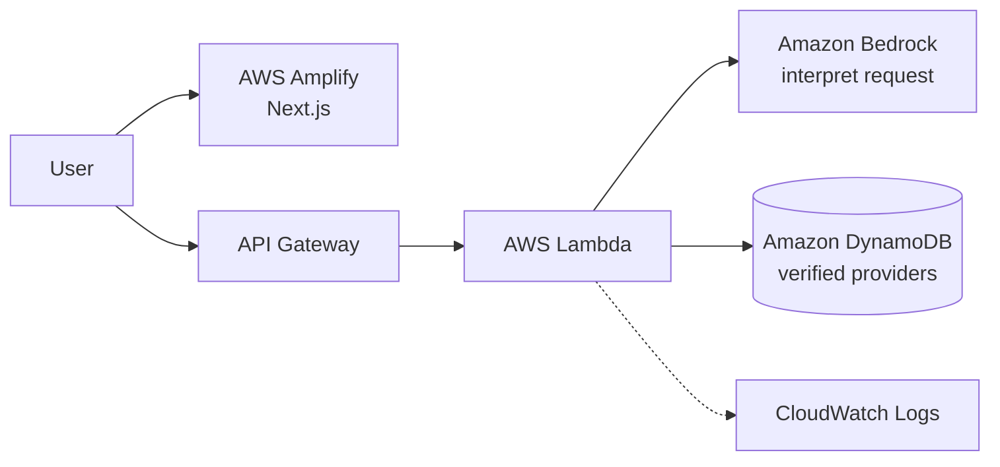

# EcoConnect

**Your local environmental action assistant.**
*"Tell us what you have. We'll help you find the right next step."*

Built for **AWS Environmental Hacks 2026** (WeMakeDevs), Waste and Energy track.

> 🚧 Status: in development during the hackathon (Oct 8–11, 2026). Live URL: _TBD_ · Demo video: _TBD_

## What it does

You describe unwanted items in plain words, for example *"I'm moving and have a dead laptop and
three bags of clothes"*. EcoConnect then:

1. **Understands** each item, its condition and quantity (Amazon Bedrock; English, Hindi and Hinglish).
2. **Recommends routes** in waste-hierarchy order: repair → reuse → donate → e-waste collection → recycle.
3. **Finds real, verified local services** in Faridabad from a curated database.
4. **Shows trust** (how and when each service was verified) and gives one-tap **Call, WhatsApp and Directions**, plus a prep checklist.

**Core principle:** Bedrock interprets the request. It **never invents providers or trust**.

## Architecture



| AWS service | Why we use it |
|---|---|
| Amplify Hosting | Hosts the Next.js frontend with CI/CD from GitHub |
| API Gateway (HTTP API) | Public API with CORS and throttling |
| Lambda | Search logic: validation, routing rules, matching and ranking |
| Bedrock | Turns messy, multi-item, multilingual text into structured item types |
| DynamoDB | Stores human-verified provider records |
| CloudWatch | Structured logs for debugging and latency tracking |

## Documentation

| Doc | Purpose |
|---|---|
| [docs/PROJECT_SPEC.md](docs/PROJECT_SPEC.md) | **Start here.** How it works, technical design, requirements, AI build plan |
| [AGENTS.md](AGENTS.md) | Rules for AI coding agents working in this repo |
| [docs/TEAM_WORKFLOW.md](docs/TEAM_WORKFLOW.md) | Team collaboration playbook, roles, Git flow & sync schedule |
| [docs/roles/](docs/roles/) | AI Role Briefs: [Member 1 (Backend)](docs/roles/MEMBER_1_BACKEND.md), [Member 2 (Frontend)](docs/roles/MEMBER_2_FRONTEND.md), [Member 3 (Data & QA)](docs/roles/MEMBER_3_DATA_QA_DEMO.md) |
| [docs/DECISIONS.md](docs/DECISIONS.md) | Architecture decision records |
| [docs/DATA_GUIDELINES.md](docs/DATA_GUIDELINES.md) | How we collect and verify provider data |
| [docs/TASKS.md](docs/TASKS.md) | Build progress tracker |
| [docs/DEMO_AND_SUBMISSION.md](docs/DEMO_AND_SUBMISSION.md) | Demo script, QA checklist, submission |

## Getting started

> Filled in during Phase 2 and Phase 5. Planned commands:

```bash
# shared code
node scripts/sync-shared.mjs

# backend
cd backend && npm ci && npm test
sam build && sam deploy --guided
npm run seed -- --file ../data/providers/faridabad.json --table <TableName>

# frontend
cd web && npm ci
echo "NEXT_PUBLIC_API_BASE_URL=<ApiUrl>" > .env.local
npm run dev
```

## Team

_TBD_