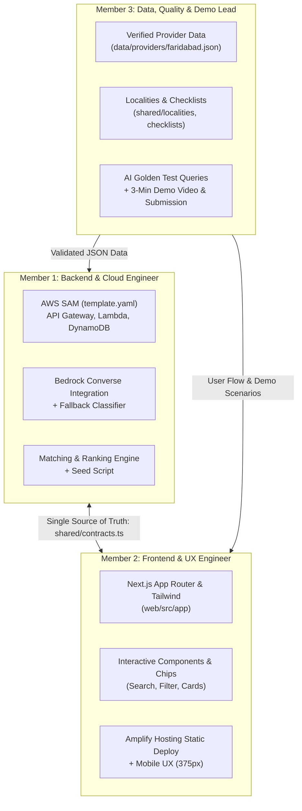

# Team Workflow & Engineering Playbook

This document defines how a 3-person team collaborates professionally to build EcoConnect during **AWS Environmental Hacks (Oct 8–11, 2026)**.

In professional software development, speed comes from **decoupling** (working without blocking each other) and **strict boundaries** (never editing each other's code blindly, especially when using AI coding assistants).

---

## 1. Role Division & Ownership



---

### Member 1: Backend & Cloud Engineer
*Title: Cloud & Backend Lead*
- **Primary Domain:** `backend/`, `template.yaml`, `scripts/`
- **Key Responsibilities:**
  1. **AWS Infrastructure:** Set up SAM template (HTTP API, Lambda, DynamoDB table, CloudWatch logs, IAM least-privilege).
  2. **Core Engine:** Implement routing rules (`rules.ts`), matching logic (`match.ts`), and geolocation distance calculator (`geo.ts`).
  3. **Amazon Bedrock:** Integrate Converse API with forced tool use (`record_interpretation`) and deterministic fallback keyword classifier.
  4. **Data Ingestion:** Write and run `seed.ts` script to validate and populate DynamoDB from `data/providers/`.
  5. **API Contract Delivery:** Expose `/search`, `/providers`, and `/health` matching the exact schema in `shared/contracts.ts`.
- **Done-Gate Checklist:**
  - `sam deploy` succeeds.
  - Unit tests pass with `npm test`.
  - Golden query evaluation passes (`npm run eval:golden`).
  - Provides working `API_URL` to Member 2.

---

### Member 2: Frontend & UX Engineer
*Title: Frontend & Experience Lead*
- **Primary Domain:** `web/`
- **Key Responsibilities:**
  1. **Client Application:** Next.js App Router (TypeScript, Tailwind CSS, static export `output: 'export'`).
  2. **Page Development:**
     - `/`: Clean search bar, example query chips, locality dropdown, category quick-browse.
     - `/search`: Interactive "We Understood" chips (editable), route hierarchy tabs, provider cards with action buttons (Call, WhatsApp, Maps).
     - `/browse` & `/browse/[itemType]`: Fast non-AI fallback browsing.
     - `/about`: Verification standards, trust explanation, AWS architecture diagram.
  3. **Responsive & Accessible Design:** Mobile-first verification (375px viewport on mobile browsers), high-contrast badges, keyboard navigation.
  4. **Contract-Based Mocking:** Can develop the entire UI against mock JSON responses immediately without waiting for Member 1 to finish deploying.
  5. **Amplify Hosting:** Configure and deploy `amplify.yml`.
- **Done-Gate Checklist:**
  - `npm run lint` and `npm run build` pass without errors.
  - Zero CORS errors when connected to Member 1's API Gateway.
  - Flawless mobile layout test on a real smartphone screen.

---

### Member 3: Data, Quality & Demo Lead
*Title: Product, Data & Submission Lead*
- **Primary Domain:** `data/`, `shared/localities.*.json`, `docs/`, Demo & Submission Assets
- **Key Responsibilities:**
  1. **Ground-Truth Data Collection (Critical Hackathon Safeguard):**
     - Find and verify real providers in Faridabad as per [`DATA_GUIDELINES.md`](DATA_GUIDELINES.md).
     - Target: 15–25 verified providers across both categories (Electronics/Batteries & Reuse/Donation).
     - Call or check official lists; document verification dates and methods.
     - **Never invent fake names or contact numbers.**
  2. **Localities & Content:**
     - Populate `shared/localities.faridabad.json` with real sector coordinates.
     - Review prep checklists and unsupported items advice.
  3. **Quality Assurance (QA) & AI Evaluation:**
     - Curate real query test cases in `backend/tests/golden-queries.json` (testing Hinglish, complex multi-item queries).
     - Perform user testing across edge cases (vague queries, invalid sectors).
  4. **3-Minute Demo Video & Final Submission:**
     - Script, rehearse, and record the 3-minute pitch video following [`DEMO_AND_SUBMISSION.md`](DEMO_AND_SUBMISSION.md).
     - Capture CloudWatch logs in the video to prove genuine AWS utilization.
     - Manage submission fields on WeMakeDevs/Devpost ahead of the deadline.
- **Done-Gate Checklist:**
  - Zero `isSample: true` records in the final production seed.
  - Recorded 3-minute demo video under the file size limit and with crisp audio.
  - Submission submitted with at least a 2-hour safety buffer.

---

## 2. Professional Collaboration Rules (Avoiding Chaos)

### Rule A: Contract-First Development (The Golden Law)
- Neither the frontend nor the backend begins hacking ad-hoc data structures.
- The interface is defined **once** in `shared/contracts.ts` and `shared/taxonomy.ts`.
- **If an API field needs to change:**
  1. Member 1 and Member 2 discuss and agree.
  2. Update `shared/contracts.ts`.
  3. Run `node scripts/sync-shared.mjs`.
  4. Both update their respective sides.

### Rule B: Git Branching & Merge Strategy
Never commit directly to `main` while 3 people are coding simultaneously.

```text
main (Always stable, deployable)
 ├── feat/contracts-scaffold   (Merged first)
 ├── feat/backend-api          (Member 1)
 ├── feat/frontend-ui          (Member 2)
 └── data/faridabad-curation   (Member 3)
```

1. **Short-lived branches:** Create branches off `main` named `feat/<name>`, `fix/<name>`, or `data/<name>`.
2. **Rebase or Pull frequently:** Run `git pull origin main` before pushing.
3. **No mega-merges at the 11th hour:** Merge small, tested pull requests at every sync checkpoint.
4. **Agent Safety:** When using AI coding agents, commit only the files relevant to your scope. Never do `git add .` without checking `git status` first.

### Rule C: Mocking Allows Zero Blockers
- **Member 2 does NOT wait for Member 1:** In `web/src/lib/api.ts`, create a toggle or fixture that returns sample search response JSON. Member 2 can polish 100% of the UI, loading states, and error handlers independently.
- **Member 1 does NOT wait for Member 3:** Member 1 tests the API using 2 sample placeholder records (`isSample: true`). When Member 3 finishes the real dataset, Member 1 simply runs `npm run seed`.

---

## 3. Integration Cadence & Standup Rhythm

Do **not** wait until Sunday afternoon to combine work. Professional teams use **timed integration gates**:

| Milestone | Target Time | Objective | Integration Check |
|---|---|---|---|
| **Sync 1: Contracts & Scaffold** | **Day 1 (Oct 9) 18:00 IST** | `shared/` contracts locked. Repo structure in place. | `node scripts/sync-shared.mjs` runs clean. All 3 have cloned and created their branches. |
| **Sync 2: First Live Handshake** | **Day 2 (Oct 10) 13:00 IST** | Backend deployed to AWS with fallback/Bedrock. Frontend wired to live API URL. | Member 2 runs a search query in Next.js; Member 1 sees the invocation in CloudWatch logs. |
| **Sync 3: Real Data Ingestion** | **Day 2 (Oct 10) 20:00 IST** | Member 3 delivers `data/providers/faridabad.json` (15+ verified entries). | Member 1 runs `npm run seed`. Frontend immediately displays real Faridabad drop points. |
| **Sync 4: Feature Freeze** | **Day 3 (Oct 11) 12:00 IST** | **Zero new features.** All code merged to `main`. | Production URL tested on a physical mobile phone. Manual QA checklist verified. |
| **Sync 5: Video & Submission** | **Day 3 (Oct 11) 15:00 IST** | Video recorded. README final. Submission drafted. | Submit to WeMakeDevs at least 2 hours before the absolute deadline. |

---

## 4. 15-Minute Standup Agenda (Run at each Sync)

Keep syncs strictly to 15 minutes:
1. **What did you complete since last sync?**
2. **What are you committing/merging right now?**
3. **Are you blocked by anything or anyone?**
4. **Confirm next milestone deadline.**

---

## 5. Emergency Troubleshooting & Contingency

- **What if Bedrock rate limits or errors during testing?**
  - Member 1 has built `CLASSIFIER_MODE=fallback`. Toggle the Lambda environment variable; search continues working deterministically.
- **What if an Amplify deployment gets stuck?**
  - Member 2 can run `next build && next export` locally and host temporarily via S3/CloudFront or direct preview while debugging.
- **What if git has merge conflicts?**
  - Because `backend/`, `web/`, and `data/` are separate folders, conflicts will only ever occur in `shared/` or `package.json`. Resolve them together on a screen share—never guess.
